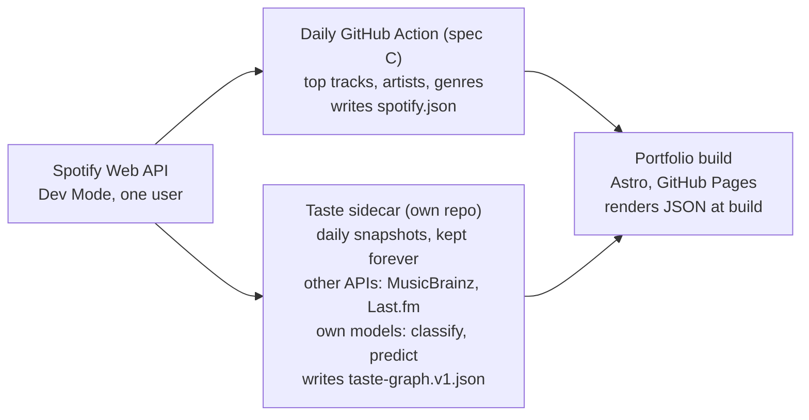

# Spotify taste sidecar: brainstorm brief

2026-11-22 · Viet Bui

## Purpose

The taste sidecar is a separate service that turns my Spotify listening into a "music taste DNA": a graph of genres, artists and traits that I classify, predict and generate with my own models and criteria. It is its own project so the portfolio stays a static site and the sidecar can grow (training, other APIs) without touching the site's build.

This brief is the starting point for a brainstorm session. Nothing here is decided except the boundary with the portfolio.

## Context

My portfolio (`vietbui1999ru.github.io`, Astro 5 with Svelte islands, deployed to GitHub Pages) is becoming a personal and professional digital garden. It is static: nothing runs at request time, and content comes from my Obsidian vault at build time.

The garden plan has four specs. Spec C adds small status widgets, and its Spotify part is deliberately simple:

- Top tracks and top artists (Spotify's ~4-week `short_term` ranking), recently played, and artist genres if the API still returns them.
- Fetched once a day by a scheduled GitHub Action, saved as JSON, rendered at build time.
- No live "now playing" yet. A Cloudflare Worker for that is deferred.

Anything beyond that raw data, such as clustering, classification, audio traits or generated output, belongs to the sidecar.

## Boundary

The portfolio owns the simple Spotify data; the sidecar owns everything derived. They meet only through files.

The site never calls the sidecar live. Live now-playing via a Worker is deferred.

The portfolio renders `spotify.json` (spec C) and, once it exists, `taste-graph.v1.json`. The sidecar can read the same Spotify account but never writes into the site's repo directly; how the JSON reaches the build (commit, release asset, fetch at build) is an open question.

## Known constraints

Spotify itself will not supply the traits a taste model needs, so the sidecar must source them elsewhere.

| Constraint | Effect on the sidecar | Confidence |
| --- | --- | --- |
| Since 27 Nov 2024, new apps lose audio features, audio analysis, recommendations and related artists | No tempo, energy, valence or similar from Spotify | From memory; verify against Spotify's developer blog |
| 2026 Dev Mode: app owner needs Premium, max 5 users, reduced endpoint set | Single-user tool only; endpoints may vanish | Researched 2026-10-31 in the portfolio's widget spec |
| Artist `genres` field | May be empty or sparse | Unverified; first task is a test call |
| Rate limits and 429 `QUOTA_EXCEEDED` in Dev Mode | Batch, cache, never poll per visitor | Researched 2026-10-31 |
| The portfolio is static on GitHub Pages | The sidecar cannot run inside it; output reaches the site as files or a fetch at build time | Fact |

Possible outside sources for traits, all to be checked in the brainstorm: MusicBrainz and AcousticBrainz-style datasets, Last.fm tags, and running my own audio or text models on metadata.

## Open questions to brainstorm

1. What is "taste DNA" concretely: a genre graph, an embedding space, a set of named traits, or all three?
2. Which signals feed it, and where does each come from once Spotify's audio features are gone?
3. What gets trained versus hand-written: which criteria are my own rules, and which are learned?
4. What does it generate: playlists, descriptions, visuals, predictions of what I will like?
5. Where does it run: homelab (Proxmox, NixOS), a laptop job, or a small cloud host? Always on, or batch?
6. How does history accumulate: Spotify only returns recent windows, so does the sidecar store daily snapshots to build a long-term record?
7. What is the output contract the portfolio reads: one JSON file of nodes and edges, versioned with a schema?
8. What stays private: raw listening history versus the published graph.

## Starting suggestions

These are defaults to push against, not decisions.

- Start with storage: a daily snapshot of top tracks, artists and recently played, kept forever. Every later model needs history, and Spotify will not give it back.
- First graph is rule-based: artists as nodes, shared genres or tags as edges, weighted by play counts. Learned models come after the graph has data.
- Keep the contract small: one versioned JSON file (`taste-graph.v1.json`) of nodes and edges that the portfolio renders. The site never calls the sidecar live.
- Run it as a batch job on the homelab; no always-on server until something needs one.

Next step: brainstorm session answers the open questions, then writes the sidecar's own spec in its own repo.
